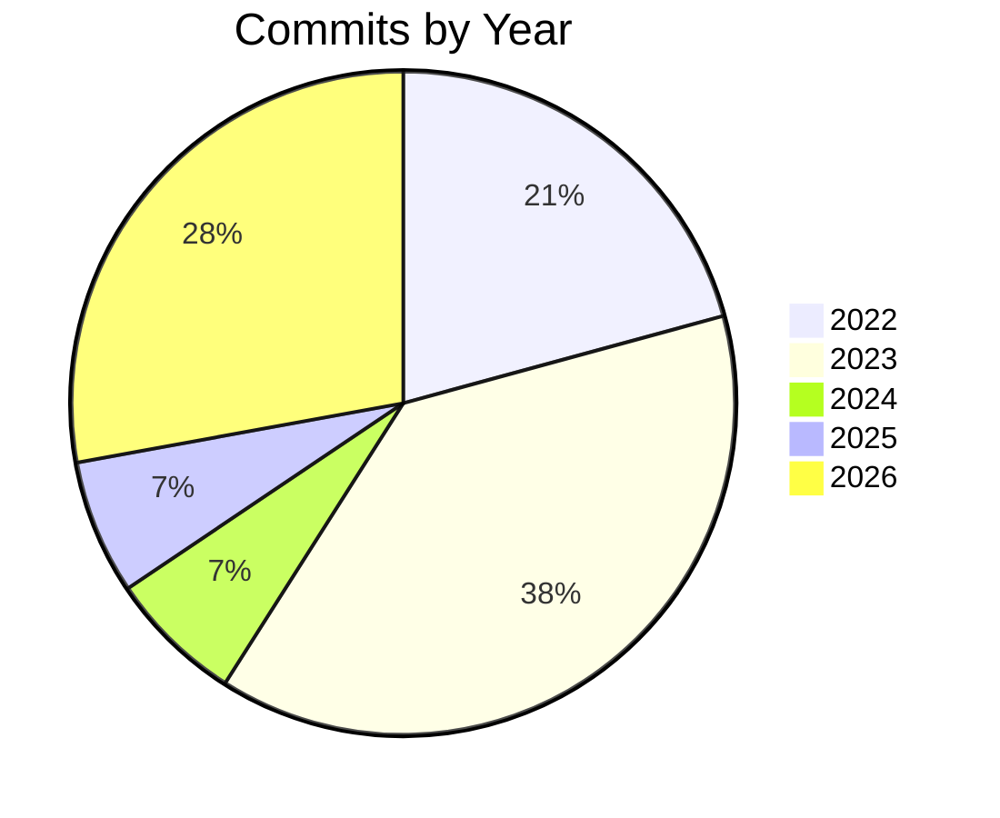

# Solution Digest

## Summary

PingUtil is a .NET console application that continuously pings a configured remote server over a working day, displaying live statistics (reply time, averages, shortest/longest, success rate) and an audible alert after a cluster of consecutive failures. Business logic lives in a `Pinger.Domain` class library behind interfaces in `Pinger.Interfaces`, with the console project wiring everything together via dependency injection. The solution targets .NET 10 and is covered by an xUnit test suite.

## Languages

| Language | Extension(s) |
|----------|-------------|
| C# | .cs |

## Modules

| Language | Count |
|----------|-------|
| C# | 26 |

## Unit Tests

| Metric | Value |
|--------|-------|
| Total tests | 74 |
| Framework | xUnit |

## Development History

| Metric | Value |
|--------|-------|
| Total commits | 183 |
| First commit | Thursday, 28 April 2022 |
| Last commit | Thursday, 5 November 2026 |
| Days | 1651 |
| Weeks | 235 |
| Months | 55 |
| Years | 4 |

## Commits by Year

